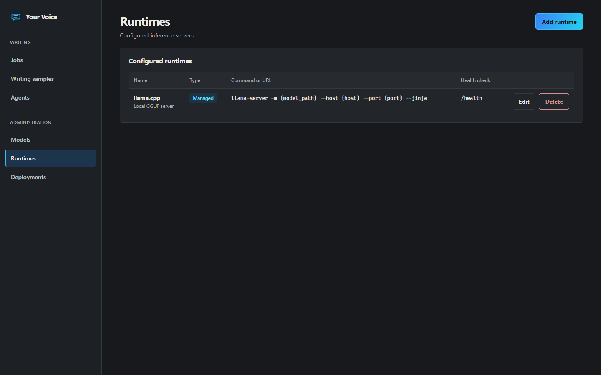
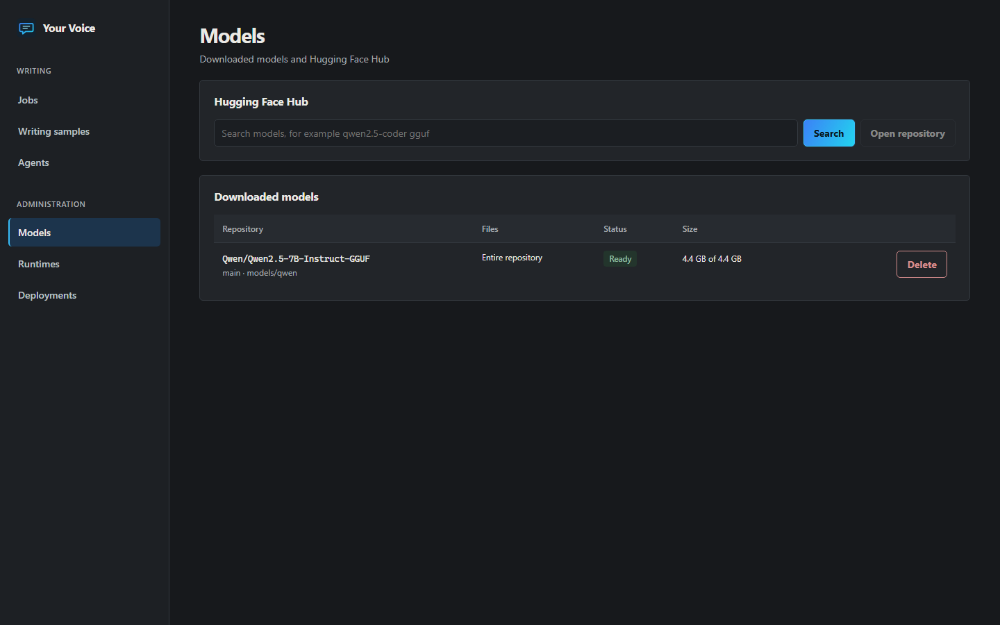
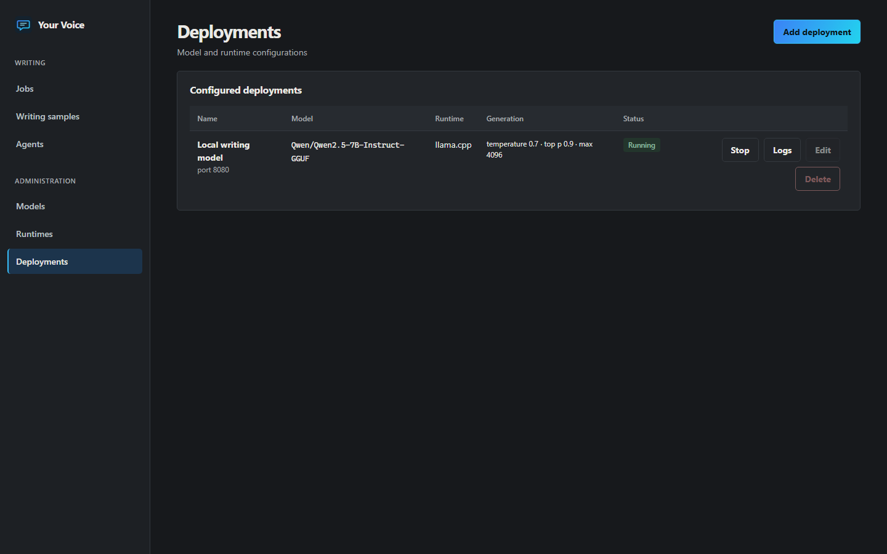
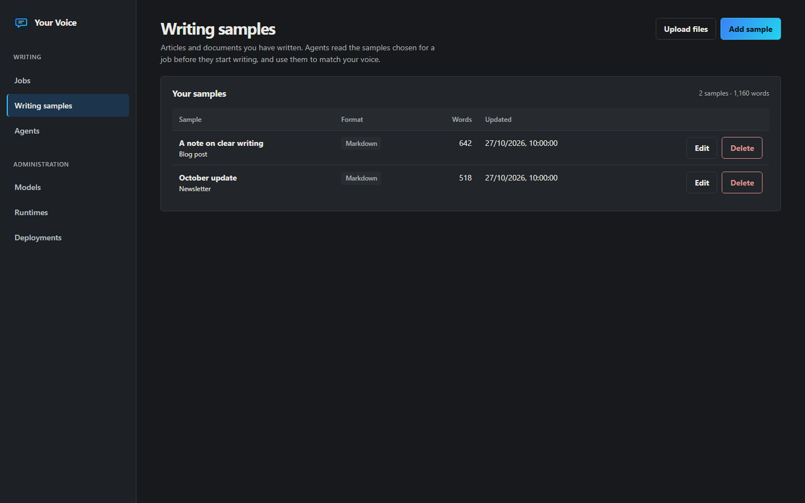
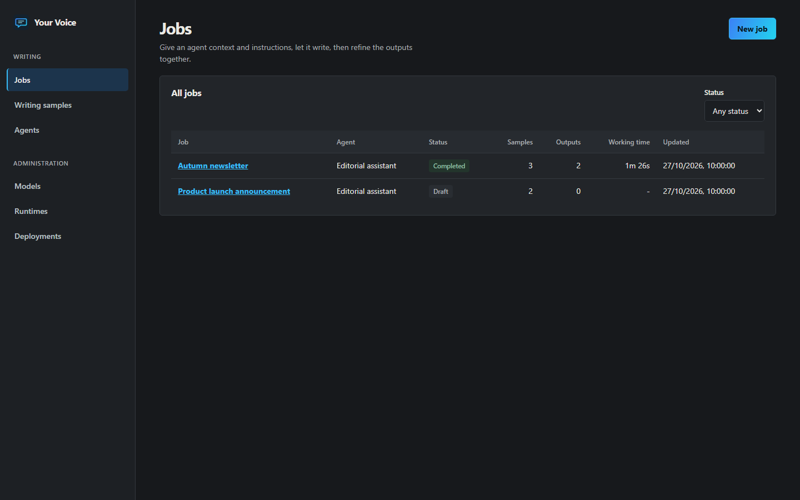
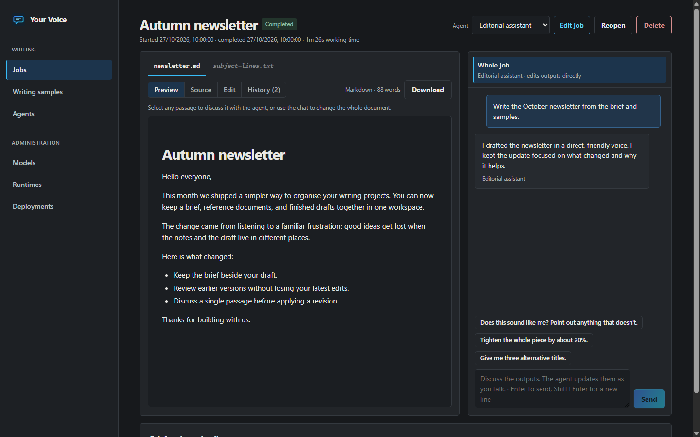

# Your Voice

Have locally hosted language models write documents in your own voice.

Generic model output is easy to spot: the same openings, the same hedging, the same
rhythm. Your Voice gives a local model examples of how you actually write, a brief for the
piece you need, and a workspace where you refine the result together.

Your Voice is a browser application for downloading models from the Hugging Face Hub,
serving them with inference runtimes such as Strata, llama.cpp, vLLM, SGLang, Ollama or
LM Studio, and assigning them as writing agents to jobs.

1. **Add writing samples**: articles and documents you have written, pasted or uploaded as
   Markdown, HTML or text.
2. **Create a job**: context such as a project README or the goal of the piece, plus
   instructions. Name the outputs you want: Markdown, HTML, plain text, or a mixture.
3. **Assign an agent**, a deployed model with optional role instructions, and start the job.
4. **The agent completes the job**. It must read every chosen sample before it may write, then
   reads the context, writes each output and finishes. You watch documents appear as they are
   generated.
5. **Discuss a passage**: select text in any output and open a discussion beside it. The agent
   talks the change through with you and proposes a revision, which is applied only when you
   apply it or tell the agent to.
6. **Discuss the whole job**: in the main conversation the agent edits the outputs directly, and
   you see the changes as they happen.

Every document change is kept as a revision that can be viewed and restored. Every
conversation, tool call and revision is stored in the database.

## Contents

- [Requirements](#requirements)
- [Installation](#installation)
- [Running the application](#running-the-application)
- [Installing runtimes](#installing-runtimes)
- [Workflow](#workflow)
- [Agent tools](#agent-tools)
- [Configuration](#configuration)
- [Development](#development)
- [Project structure](#project-structure)
- [Brand assets](#brand-assets)

## Requirements

| Component | Version | Notes |
| --- | --- | --- |
| Python | 3.11 or later | Runs the backend. |
| Node.js | 20 or later | Only needed to build the frontend. |
| A runtime | See [Installing runtimes](#installing-runtimes) | Must expose an OpenAI-compatible chat completions API with tool calling. |

Supported platforms are Windows 10 and 11, Windows Subsystem for Linux 2 (WSL) and Linux.

## Installation

### Windows (PowerShell)

```powershell
git clone https://github.com/CogniTechSystems/your-voice.git
cd your-voice
.\scripts\setup.ps1
```

If script execution is disabled, run
`powershell -ExecutionPolicy Bypass -File .\scripts\setup.ps1` instead.

### Linux and WSL (bash)

```bash
git clone https://github.com/CogniTechSystems/your-voice.git
cd your-voice
bash scripts/setup.sh
```

On Debian and Ubuntu, install `python3-venv` first if it is missing:
`sudo apt install python3-venv`.

The setup scripts create a virtual environment in `backend/.venv`, install the backend and
build the frontend into `frontend/dist`. Pass `-SkipFrontend` (PowerShell) or
`--skip-frontend` (bash) to install only the backend.

### Sharing one checkout between Windows and WSL

When the repository lives on a Windows drive and is used from WSL through `/mnt/<drive>`,
the bash scripts automatically keep the WSL virtual environment in
`~/.venvs/your-voice` and the data directory in
`~/.local/share/your-voice`. This avoids conflicts with the Windows virtual
environment and the unreliable SQLite file locking on Windows mounts. Override either location
with `YV_VENV` and `YV_DATA_DIR`.

The built frontend is platform independent, so it only needs to be built once. `npm ci`
replaces `node_modules` with platform-specific binaries, so on a shared checkout run it from
one environment only and use `--skip-frontend` in the other.

## Running the application

```powershell
.\scripts\start.ps1        # Windows
```

```bash
bash scripts/start.sh      # Linux and WSL
```

Open <http://127.0.0.1:8100>. The database is created and migrated automatically on first
start.

To reach the interface from another machine, set `YV_HOST=0.0.0.0`. The application has no
authentication, so only do this on a trusted network.

The screenshots below show this application's frontend with sample API data prepared for the
documentation. They illustrate the interface; they do not represent a completed model run.

## Installing runtimes

A runtime is any server that implements the OpenAI chat completions API, including tool
calling. Runtimes are added as entries on the **Administration > Runtimes** page and come in
two kinds:

- **Managed**: the application launches the server from a command template when a deployment
  starts, captures its output into the database and stops it on request.
- **External**: the server is already running, and the application connects to its base URL.

The runtime form includes presets for each of the runtimes below. Install the runtime first
using its official documentation, then add the entry.



| Runtime | Kind | Platforms | Model format | Official documentation |
| --- | --- | --- | --- | --- |
| Strata | External | Windows | Managed by Strata | Provided with the Strata installation |
| llama.cpp | Managed | Windows, Linux, WSL | GGUF file | [Installation](https://github.com/ggml-org/llama.cpp/blob/master/docs/install.md), [server](https://github.com/ggml-org/llama.cpp/tree/master/tools/server), [function calling](https://github.com/ggml-org/llama.cpp/blob/master/docs/function-calling.md) |
| vLLM | Managed | Linux, WSL | Safetensors repository | [Installation](https://docs.vllm.ai/en/latest/getting_started/installation/), [tool calling](https://docs.vllm.ai/en/latest/features/tool_calling.html) |
| SGLang | Managed | Linux, WSL | Safetensors repository | [Installation](https://docs.sglang.ai/get_started/install.html), [tool parser](https://docs.sglang.ai/advanced_features/tool_parser.html) |
| Ollama | External | Windows, Linux, WSL | Managed by Ollama | [Download](https://ollama.com/download), [OpenAI compatibility](https://docs.ollama.com/api/openai-compatibility) |
| LM Studio | External | Windows, Linux | Managed by LM Studio | [Download](https://lmstudio.ai/download), [local server](https://lmstudio.ai/docs/developer) |

### Strata

Strata exposes an OpenAI-compatible API on `http://127.0.0.1:47831` while it is running.

1. Add a runtime from the **Strata (external)** preset.
2. On the **Models** page, enter a repository ID for the model loaded in Strata and choose
   **Register only**. Strata manages its own model files, so nothing is downloaded.
3. Create a deployment with the **Served model name** set to the Strata model ID, for
   example `iq3_s`. The available IDs are listed at `http://127.0.0.1:47831/v1/models`.

### llama.cpp

On Linux or WSL, install a Linux release build or build llama.cpp from source using its
[official installation guide](https://github.com/ggml-org/llama.cpp/blob/master/docs/install.md).
On Windows, install a Windows release build or build from source using the same guide. Make
sure `llama-server` is on `PATH`, or put its full path in the command template.

Download a GGUF repository, selecting a single quantisation file, and pick that file as the
**Model file** of the deployment. The preset command passes `--jinja`, which llama.cpp
requires for native tool calling. Add GPU offloading with the deployment's extra launch
arguments, for example `-ngl 99`.

### vLLM and SGLang

Both run on Linux only, so on Windows run them and this application inside WSL. Install them
into their own virtual environment as described in their documentation, and make sure the
`vllm` command, or the `python` interpreter that has SGLang installed, is on `PATH` when you
start the application. Download the full safetensors repository and leave **Model file** set
to the entire model directory. Choose the tool call parser that matches the model family; the
presets use `hermes` for vLLM and `qwen25` for SGLang.

### Ollama and LM Studio

These manage their own model storage. Register the model on the **Models** page with
**Register only**, and set the deployment's **Served model name** to the model name the
runtime uses, for example `qwen2.5-coder:7b` for Ollama. Ollama can also pull models
directly from the Hub, for example `ollama pull hf.co/Qwen/Qwen2.5-Coder-7B-Instruct-GGUF:Q4_K_M`.

### Command templates

Managed runtime commands may use these placeholders:

| Placeholder | Value |
| --- | --- |
| `{model_path}` | The deployment's model file, or the model directory if no file is selected. |
| `{model_dir}` | The model's download directory. |
| `{host}` | The host the runtime should bind to (`YV_RUNTIME_HOST`). |
| `{port}` | A free port chosen when the deployment starts. |
| `{served_model_name}` | The deployment's served model name, or the repository ID. |

Arguments are split using the quoting rules of the host platform before placeholders are
substituted, so paths containing spaces are passed correctly. Wrap executable paths that
contain spaces in double quotes.

## Workflow

### Setting up

1. **Models**: search the Hugging Face Hub, choose the files to download and track download
   progress. Set `YV_HF_TOKEN` to access gated repositories.
2. **Runtimes**: add an entry for each installed runtime.
3. **Deployments**: pair a model with a runtime, choose the model file, launch arguments and
   generation settings, then start it. Runtime output is shown on the same page.
4. **Agents**: give a deployment a name and, optionally, role instructions, for example
   "You write technical blog posts for developers." Jobs are assigned to agents.





Writing is a long-output task, so give deployments a generous **Max tokens** setting and a
context window large enough for your samples, the context documents and the outputs.

### Writing samples

Add pieces you are happy with on the **Writing samples** page, by pasting them or uploading
`.md`, `.html` or `.txt` files. Notes on a sample, such as where it was published, are shown to
the agent. A few samples close to the kind of writing you want work better than many unrelated
ones, particularly with the limited context of local models.



### Jobs

A job has a title, instructions, any number of context documents, the writing samples to read
and, optionally, the output files to produce. The file extension sets each output's format:
`.md` for Markdown, `.html` for a standalone HTML page and `.txt` for plain text. Without named
outputs the agent chooses the files itself.



Starting a job opens its main conversation and sends the first turn. The agent:

1. reads every chosen writing sample; writing tools refuse to run until it has,
2. reads the context documents,
3. writes each output with `write_document`, streamed live into the workspace,
4. calls `finish_job` once every requested output exists.

Jobs are **draft** until started, then **active**, then **completed**. A job can also be marked
complete, cancelled, reopened or reassigned to another agent from the workspace.

### The workspace

The left side shows the outputs, with a rendered preview, the source, a plain editor and the
revision history. HTML is rendered in a sandboxed frame with scripts disabled. The right side
holds the conversations.

- **Whole job**: the main conversation. Ask for changes to any output and the agent makes them
  straight away with `write_document` or `edit_document`.
- **Highlights**: select a passage in a preview or the source and choose **Discuss selection**.
  The passage stays highlighted while its conversation is open. The agent discusses the change
  first, then calls `propose_revision`. The proposal is shown in the chat as a before and after,
  with **Apply** and **Reject** buttons. The agent can apply a proposal itself only after you
  have replied to it. Resolve a discussion when you are done with it.

One conversation per job runs at a time, so the agent never edits a document from two places
at once. Your own edits, applied proposals and restored revisions are recorded as revisions
alongside the agent's.



## Agent tools

| Tool | Available in | Purpose |
| --- | --- | --- |
| `list_samples`, `read_sample` | All conversations | Read the author's writing samples. Reading is tracked per job. |
| `list_context`, `read_context` | All conversations | Read the job's context documents. |
| `list_documents`, `read_document` | All conversations | Read the current outputs. |
| `write_document` | Main conversation | Create an output or replace its content. |
| `edit_document` | Main conversation | Replace one unique passage of an output. |
| `finish_job` | Main conversation, active jobs | Complete the job once every requested output exists. |
| `propose_revision` | Highlight conversations | Propose replacing a passage of the highlighted document. |
| `apply_revision` | Highlight conversations | Apply a pending proposal after the user has replied to it. |

Passages are matched exactly, or with differences in whitespace ignored, and must occur once.

## Configuration

Settings are read from environment variables prefixed with `YV_`, or from a `.env` file in
the repository root. See [.env.example](.env.example).

| Variable | Default | Description |
| --- | --- | --- |
| `YV_DATA_DIR` | `./data` | Database and downloaded models. |
| `YV_DATABASE_URL` | SQLite in the data directory | Any SQLAlchemy URL. For PostgreSQL, install the `postgres` extra and use `postgresql+psycopg://...`. |
| `YV_HOST`, `YV_PORT` | `127.0.0.1`, `8100` | Address of the web application. |
| `YV_HF_TOKEN` | Not set | Hugging Face access token. |
| `YV_RUNTIME_HOST` | `127.0.0.1` | Host that managed runtimes bind to. |
| `YV_AGENT_MAX_ITERATIONS` | `60` | Maximum model calls per message. |
| `YV_TOOL_OUTPUT_LIMIT` | `20000` | Maximum characters returned by a tool. Longer samples and documents are read in line ranges. |
| `YV_DOCUMENT_CHARACTER_LIMIT` | `200000` | Largest output document. |

### Networking between Windows and WSL

When the application and a runtime run on different sides of the WSL boundary, `127.0.0.1`
may not reach the other side. Enable
[mirrored networking](https://learn.microsoft.com/windows/wsl/networking#mirrored-mode-networking)
in WSL, or use the other side's IP address in the external runtime's base URL.

## Development

Run the backend with automatic reload and the frontend development server in two terminals:

```bash
cd backend
.venv/bin/uvicorn app.main:app --reload
```

On Windows, use `.venv\Scripts\uvicorn.exe app.main:app --reload` from `backend`.

```bash
cd frontend
npm run dev
```

The development server runs on <http://127.0.0.1:5174> and proxies `/api` to the backend.
Set `YV_BACKEND_URL` to proxy to another address.

### Quality checks

```bash
cd backend
.venv/bin/python -m pytest
.venv/bin/ruff check app tests migrations
.venv/bin/ruff format --check app tests migrations
.venv/bin/mypy app
```

On Windows, replace `.venv/bin/python` with `.venv\Scripts\python.exe`. Run `npm.cmd`
instead of `npm` in PowerShell if your execution policy blocks the npm PowerShell shim.

```bash
cd frontend
npm run typecheck
npm run lint
npm run build
```

### Database migrations

The schema is managed with Alembic and upgraded automatically at startup. After changing
the models in `backend/app/models`, create a migration from the `backend` directory:

```bash
.venv/bin/alembic revision --autogenerate -m "Describe the change"
```

On Windows, use `.venv\Scripts\alembic.exe`.

Review the generated file before committing it.

### API

The REST API is served under `/api`. Interactive documentation is available at
<http://127.0.0.1:8100/docs> while the application is running.

## Project structure

```text
backend/
  app/
    api/            REST endpoints
    models/         SQLAlchemy models
    schemas/        Request and response schemas
    services/
      agent/        System prompts, tools, live writing and the agent turn loop
      documents.py  Writing documents, proposals and revisions
      huggingface.py Hub search and downloads
      jobs.py       Job lifecycle
      runtime_manager.py Runtime process management
      text_edits.py Locating and replacing passages
  migrations/       Alembic migrations
  tests/
frontend/           React and TypeScript user interface
scripts/            Setup and start scripts for PowerShell and bash
```

## Brand assets

The [brand asset pack](assets/branding/README.md) includes editable SVG masters and ready to
upload PNG and JPG exports for 1280 × 720, 1200 × 630, square, portrait, story, and wide header
formats. It also includes a profile image and favicon. The application serves the matching
favicon and touch icon from `frontend/public/`.

## Licence

Released under the GNU Affero General Public License v3.0. See [LICENSE](LICENSE).
